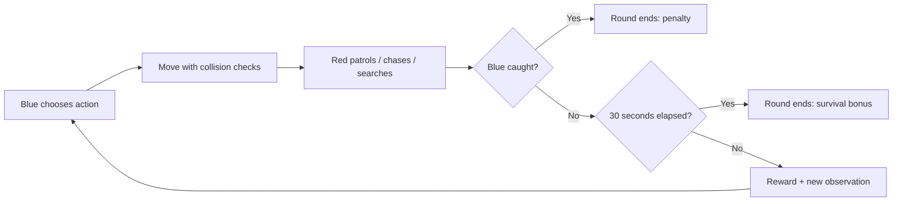

<div align="center">
  

  <p><strong>A tiny game about learning to disappear.</strong></p>

  <p>
    
    
    
    
  </p>

  <p><a href="#-quick-start">Quick start</a> · <a href="#-how-the-game-works">Gameplay</a> · <a href="#-the-learning-problem">RL design</a> · <a href="#-project-map">Code map</a> · <a href="#-showcase-checklist">Class showcase</a></p>
</div>

---

## ✨ The pitch

**Red** is a scripted hunter. **Blue** is a reinforcement-learning agent trying to survive for **30 seconds**. Red sees only inside a **100° vision cone**, and solid walls block its view. When Blue slips out of sight, Red searches its **last known position**, then resumes patrolling.

> **One agent learns. The other follows rules.** This is deliberately *not* simultaneous multi-agent RL: the simpler setup keeps the learning problem tractable for a short classroom project.

<table>
<tr><td width="50%"><strong>🔴 THE SEEKER</strong><br/>Patrols, spots, chases, remembers last-seen locations, and sidesteps obstacles.</td><td width="50%"><strong>🔵 THE HIDER</strong><br/>Chooses one of five actions using limited observations and learns through PPO.</td></tr>
<tr><td><strong>👁️ VISION</strong><br/>100° total angle · 240 px range · walls block line of sight · detection within 37 px.</td><td><strong>⏱️ SURVIVAL</strong><br/>300 simulation steps per round · 10 steps/s · survive until the timer reaches 30 seconds.</td></tr>
</table>

## 🚀 Quick start

**1. Create a virtual environment** (Python 3.10+ recommended):

```bash
python -m venv .venv
```

```powershell
# Windows PowerShell
.venv\Scripts\Activate.ps1
```

```bash
# Linux / macOS
source .venv/bin/activate
```

**2. Install dependencies:**

```bash
python -m pip install -r requirements.txt
```

**3. Play against the seeker immediately:**

```bash
python hide_seek.py --mode demo --policy human
```

**4. Compare baselines or train a model:**

```bash
# Hider acts randomly
python hide_seek.py --mode demo --policy random

# Simple hand-coded evasive baseline (not RL)
python hide_seek.py --mode demo --policy heuristic

# Train PPO — no game window, saved to models/hider_ppo.zip
python hide_seek.py --mode train --steps 200000

# Watch the trained model (requires a saved checkpoint)
python hide_seek.py --mode demo --policy ppo
```

| Control | Action |
|:--|:--|
| `W A S D` or arrow keys | Move Blue in human mode |
| `SPACE` | Pause / resume |
| `R` | Restart round |
| `ESC` | Quit |

> [!NOTE]
> The repository contains **training code, not a pre-trained model**. The `ppo` demo works only after you train a checkpoint. **200k steps are a starting setting**, not a promise that the learned behavior will outperform a baseline.

## 🎮 How the game works



The red area rendered on screen is a **wall-clipped vision cone**, not unrestricted radar. The seeker may still detect Blue at **very close range**, even outside the angular cone. Blue only receives exact seeker-relative coordinates when its own limited sensing condition is met; otherwise it relies on short-lived memory and nearby clearance measurements.

## 🧠 The learning problem

| RL element | Implementation |
|:--|:--|
| **Agent** | Blue hider only |
| **Algorithm** | Proximal Policy Optimization (PPO), Stable-Baselines3 |
| **Action space** | `Discrete(5)` — stay, up, down, left, right |
| **Observation** | 15 normalized features: position, sensed seeker, spotted flag, obstacle clearances, last-seen memory, time, proximity |
| **Episode horizon** | 300 simulation steps |
| **Training policy** | MLP `[128, 128]`, `gamma=0.99`, `learning_rate=3e-4` |
| **Checkpoint** | `models/hider_ppo.zip` |

### The reward, at a glance

```text
+0.015  each step survived
+0.025  additional reward while unseen
+0.200  spotted → unseen transition (20-step cooldown)
-0.012  attempted movement that was blocked
-10.00  caught by seeker
+10.00  survived the entire round
```

The extra unseen reward makes *breaking visibility* attractive, not just running in a straight line. It does **not** guarantee intelligent hiding: reward hacking, circling, or boundary-hugging remain possible. Evaluate the policy rather than assuming the reward produces the intended strategy.

## 🗂️ Project map

```text
hide_seek_rl/
├── assets/
│   └── banner.svg       # README artwork
├── hide_seek.py          # CLI entry point
├── config.py             # Arena, walls, speeds, vision constants
├── geometry.py           # Angular math, wall intersection
├── environment.py        # Gymnasium state, dynamics, rewards
├── policies.py           # Heuristic baseline
├── training.py           # PPO training and checkpoint saving
├── rendering.py          # Pygame arena and clipped vision cone
├── demo.py               # Live loop + player controls
├── requirements.txt
└── models/                # Created when training
```

### Where to make changes

| If you want to… | Open… |
|:--|:--|
| Adjust cone width, arena, walls or movement speed | [`config.py`](config.py) |
| Modify what Blue observes or how it is rewarded | [`environment.py`](environment.py) |
| Tune PPO learning rate, layers or batch size | [`training.py`](training.py) |
| Restyle the arena, agents or on-screen HUD | [`rendering.py`](rendering.py) |
| Change the hand-coded hider for comparison | [`policies.py`](policies.py) |
| Add game controls / policy selection | [`demo.py`](demo.py) |

## 📊 Showcase checklist

- [ ] Show **human mode** to explain the cone and wall occlusion.
- [ ] Run **random** and **heuristic** policies as easy-to-understand baselines.
- [ ] Train PPO and save the checkpoint.
- [ ] Compare **mean survival time**, **survival rate** and **time spotted** over multiple fixed evaluation seeds.
- [ ] Show *both* successful hiding and failure cases — especially corners where Red gets stuck.
- [ ] Explain why a fixed scripted seeker keeps this a **single-agent** RL experiment.

### Suggested comparison table (fill after running experiments)

| Policy | Mean survival (s) | Survived 30s (%) | Time visible (%) |
|:--|--:|--:|--:|
| Random | TBD | TBD | TBD |
| Heuristic | TBD | TBD | TBD |
| PPO | TBD | TBD | TBD |

> [!IMPORTANT]
> **No experimental results are claimed in this README.** A reliable evaluation should use the same randomized initial conditions/seeds for each policy and report a reasonable number of episodes.

## 🛠️ Tech stack

**Python** · **NumPy** · **Gymnasium** · **Stable-Baselines3** · **PyTorch** (installed through SB3) · **Pygame**

---

<div align="center">
  <strong>Hide well. Learn faster. Stay unseen.</strong><br/>
  <sub>Built as a compact classroom demonstration of partial observability and reward-driven behavior.</sub>
</div>
